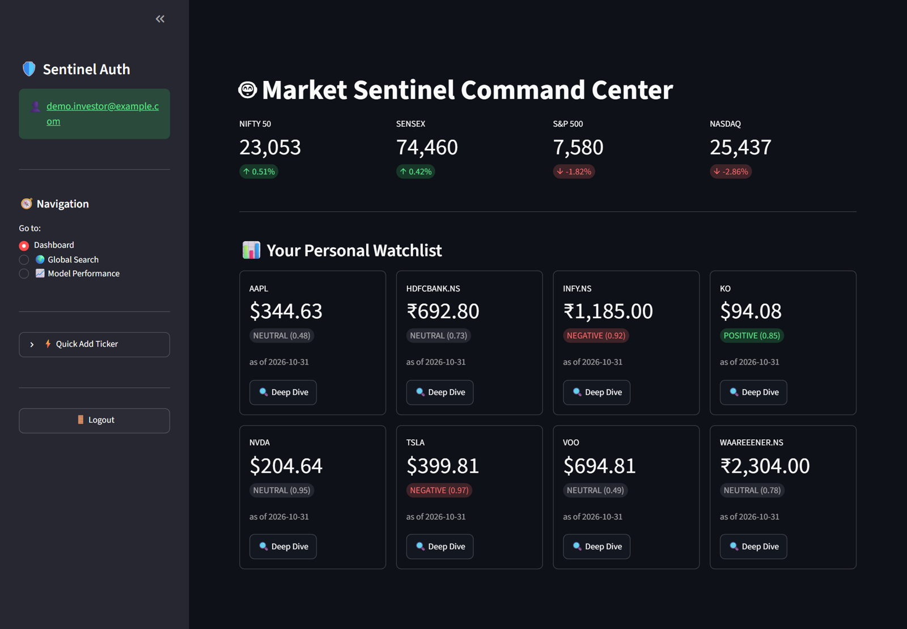
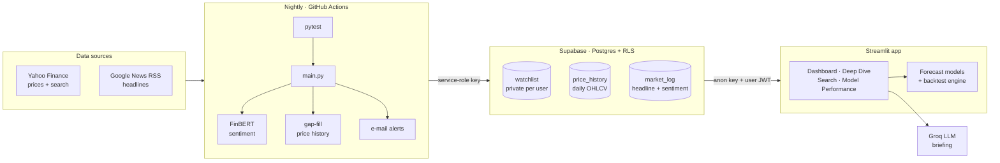
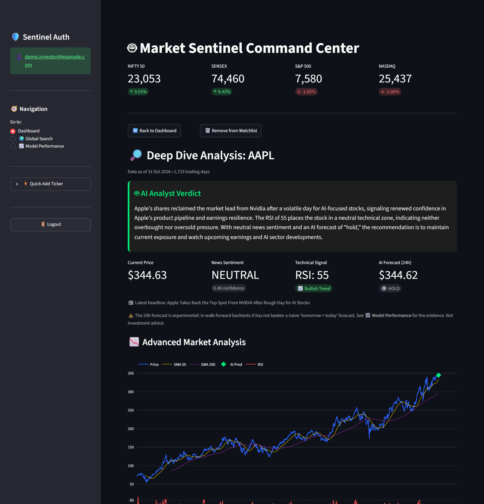
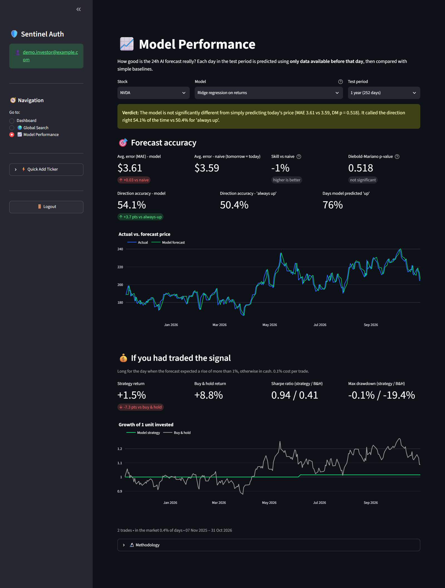
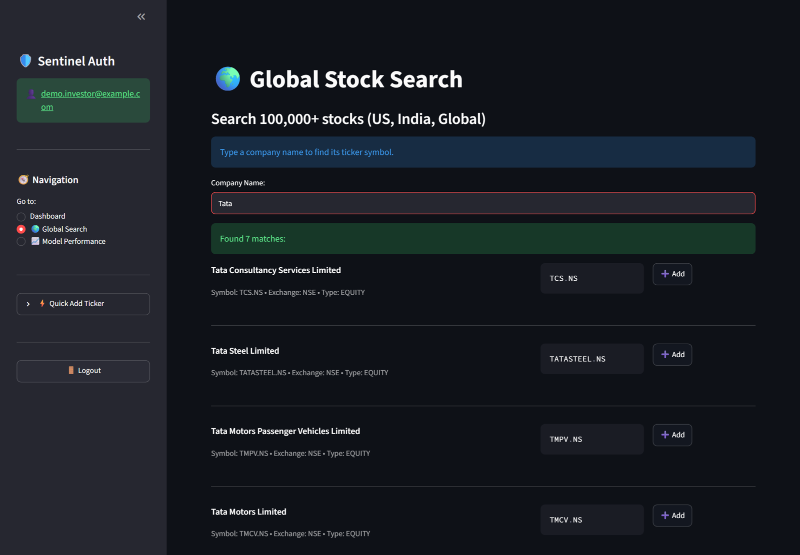

# 🤖 Market Sentinel

**A multi-user market-intelligence platform that combines FinBERT news sentiment, technical analysis and LLM briefings, and a rigorously backtested forecasting study showing why "AI stock predictions" usually fail.**

[](https://market-sentinel-news.streamlit.app/)


### 🚀 [Live demo: market-sentinel-news.streamlit.app](https://market-sentinel-news.streamlit.app/)
Log in with the demo account **`demo@example.com`** / **`SentinelDemo2026`** (shown on the login screen; reset nightly), or sign up for your own private watchlist.



---

## Overview

Market Sentinel tracks a personal watchlist of US and Indian stocks. A scheduled pipeline collects prices and news every trading day and scores each headline with **FinBERT**. The web app turns those numbers into a plain-English briefing written by an **LLM**. Each user signs in to a private watchlist, protected by Postgres **Row-Level Security**.

The project also asks a research question: **can the app's next-day price forecast beat a trivial baseline?** A walk-forward backtest over 13 stocks and 3,214 out-of-sample predictions gave a clear answer, described under [Research findings](#-research-findings).

## ✨ Features

| | |
|---|---|
| 🔐 **Private multi-user watchlists** | Supabase Auth with Postgres RLS. Each browser session gets its own authenticated client; anonymous users can read nothing. |
| 🌍 **Global search** | Find any listed instrument (NSE, BSE, NYSE, NASDAQ, …) via Yahoo's search API. Adding a stock downloads 2 years of daily history automatically. |
| 📰 **News sentiment** | Daily headlines from Google News RSS (Yahoo RSS as fallback), classified as positive, negative or neutral by FinBERT (`ProsusAI/finbert`). |
| 📉 **Technical analysis** | Interactive Plotly chart with SMA-50/200, RSI-14 and a 24h forecast marker. |
| 🤖 **AI analyst briefing** | An open-weight LLM (`gpt-oss-120b` via Groq) writes a three-sentence briefing from price, RSI, sentiment, headline and forecast. Cached per data snapshot. |
| 📈 **Model Performance page** | Interactive walk-forward backtest for any stock and model: error vs. naive, Diebold-Mariano test, direction accuracy, and a trading simulation vs. buy & hold. |
| 🩹 **Self-healing pipeline** | A GitHub Actions job (weekdays 21:00 UTC) runs the tests, then scans prices and news, scores sentiment, fills gaps in price history and sends alerts. |
| 🔔 **Risk alerts** | Optional e-mail when a stock gets high-confidence negative news. |

## 🏗️ Architecture



The nightly robot uses the **service-role key** because it reads every user's watchlist. The public app uses only the **anon key plus the logged-in user's token**, so RLS is enforced on every query.

## 🔬 Research findings

**Question:** does the 24h price forecast shown in the app have real predictive skill?

**Method:** walk-forward evaluation. For each of the last 252 trading days, each model is trained only on data *before* that day (re-trained every 21 days) and predicts that day. Automated tests verify that no future data leaks into any prediction or feature. Models are compared with:
- the **naive forecast** ("tomorrow = today"), using a **Diebold-Mariano** test on absolute errors
- **50% direction accuracy**, using a pooled binomial test
- **buy & hold**, using a long-or-cash trading simulation with 0.1% cost per trade

**Results:** 13 stocks (US + India) × 252 trading days = 3,214 predictions, ending 30 Oct 2026.

| Model | Error vs. naive | Significantly worse than naive | Direction accuracy | Binomial p |
|---|---|---|---|---|
| Random Forest on 60-day price windows (V2) | **−110 %** | 13 / 13 | 49.8 % | 0.62 |
| **Ridge regression on returns (current)** | **−2.5 %** | 6 / 13 | 49.8 % | 0.62 |
| Gradient boosting on returns | −4.6 % | 5 / 13 | 49.3 % | 0.81 |
| Gradient boosting on returns + FinBERT sentiment | −4.5 % | 5 / 13 | 49.3 % | 0.80 |

*Error vs. naive = 1 − MAE(model) / MAE(naive); negative means worse than naive. Full tables: [`results/`](results/).*

**What this shows**
1. **The original model was broken in a way a demo would never reveal.** A tree ensemble trained on raw price *levels* can only output averages of prices it has seen, so it cannot follow a stock into a new price range. Its error was more than double the naive forecast on every stock.
2. **Learning returns instead of price levels closes about 98% of that gap.** The current model predicts tomorrow's log-return from engineered features (lagged returns, momentum, volatility, RSI, distance from moving averages) and converts it back to a price.
3. **No model beats the naive forecast or a coin flip on direction.** This matches the weak-form efficient-market hypothesis for daily moves. The app therefore labels its forecast as *experimental* and links to the evidence.
4. **News sentiment added no measurable value, but this result is inconclusive.** Only about 100 days of sentiment history exist (collection paused Jun–Oct 2026), so a dedicated sentiment–return study is planned once more data has accumulated.

## 📸 Screenshots

| Deep Dive: briefing, signals, chart | Model Performance: walk-forward backtest |
|---|---|
|  |  |

| Global search | Dashboard |
|---|---|
|  |  |

## 🛠️ Engineering highlights

- **Security:** found and fixed two data-exposure issues. A module-level database client shared one login across all Streamlit visitors, and a permissive RLS policy let anyone read every watchlist. Both now have tests: a unit test for session isolation, and a live two-user RLS check (9/9).
- **Data integrity:**
  - Normalized three different timestamp conventions (UTC, New York and India midnight) to one row per trading day, with a unique key so upserts are idempotent.
  - Removed a hardcoded cut-off date that silently dropped months of data.
  - Paged past the 1,000-row API limit.
  - Removed look-ahead from moving-average back-filling.
- **Resilience to upstream changes:** Yahoo's per-ticker news feed stopped returning articles, and Groq retired the original Llama model. Both were detected and replaced, and the model name is now configurable.
- **Testing and CI:** 31 offline unit tests (indicators, merge logic, look-ahead checks, backtest accounting, RSS parsing, alert escaping). The nightly scan runs only after the tests pass, and every change lands through a pull request with CI.

## 🧰 Tech stack

| Layer | Technology |
|---|---|
| Frontend | Streamlit, Plotly |
| Database, auth and security | Supabase (PostgreSQL, Auth, Row-Level Security) |
| NLP | Hugging Face Transformers, FinBERT |
| Forecasting and evaluation | scikit-learn (Ridge, HistGradientBoosting, RandomForest), SciPy |
| Generative AI | Groq API (`openai/gpt-oss-120b`) |
| Data | yfinance, Yahoo search API, Google News RSS |
| Automation | GitHub Actions (CI and nightly cron) |

## 📁 Project structure

```
app.py                 Streamlit UI: dashboard, deep dive, model performance, search
main.py                Nightly pipeline: ingest -> sentiment -> save -> gap-fill -> alerts
fetch_data.py          Prices (yfinance) and headlines (Google News / Yahoo RSS)
sentiment_engine.py    FinBERT classifier
analysis_engine.py     SMA-50/200, RSI-14, technical signal
prediction_engine.py   Feature engineering, forecasting models, production model
backtest_engine.py     Walk-forward backtest, Diebold-Mariano, trading simulation, model comparison
ai_analyst.py          LLM briefing
database.py            Supabase access, per-session auth, history/log merge, backfill
backfill_manager.py    CLI to gap-fill or fully re-download price history
alert_system.py        E-mail alerts
supabase/schema.sql    Tables, constraints and RLS policies (idempotent)
results/               Backtest and model-comparison outputs
tests/                 Unit tests (pytest)
```

## ⚙️ Run locally

**1. Install** (Python 3.12+)
```bash
git clone https://github.com/kanishk2705/Stock-Market-News-Sentiment-Analysis.git
cd Stock-Market-News-Sentiment-Analysis
python -m venv .venv && source .venv/bin/activate      # Windows: .venv\Scripts\activate
pip install -r requirements.txt            # web app only
pip install -r requirements-pipeline.txt   # + FinBERT, for main.py
```

**2. Create the database.** In a Supabase project, run [`supabase/schema.sql`](supabase/schema.sql) in the SQL editor.

**3. Configure** a `.env` file in the project root:
```ini
SUPABASE_URL="https://<project>.supabase.co"
SUPABASE_KEY="<anon key>"                       # used by the web app
SUPABASE_SERVICE_ROLE_KEY="<service role key>"  # used by the nightly pipeline only
GROQ_API_KEY="gsk_..."
# optional
GROQ_MODEL="openai/gpt-oss-120b"
EMAIL_SENDER="you@gmail.com"
EMAIL_PASSWORD="<gmail app password>"
```

**4. Run**
```bash
streamlit run app.py                     # web app
python main.py                           # one pipeline run (prices, news, sentiment, gap-fill, alerts)
python backtest_engine.py                # backtest the production model -> results/backtest_summary.md
python backtest_engine.py --compare      # compare all models -> results/model_comparison.md
pytest -q                                # unit tests (no network or database needed)
```

## 🧭 Limitations and next steps

- **Sentiment history is short** (about 100 trading days per stock). A dedicated study (sentiment → next-day return, event-study and Granger tests) is planned once more data has accumulated.
- Headlines are the most recent ones per stock, not timestamp-aligned to market open or close. That is acceptable for daily resolution but would matter intraday.
- Free data sources (Yahoo, Google News) have no SLA. The pipeline uses fallbacks and logs failures, but coverage of small caps and ETFs is thinner.

> ⚠️ **Educational project, not investment advice.** The forecasting results above explain why.

---

**Author:** A C Kanishk · [GitHub](https://github.com/kanishk2705)
